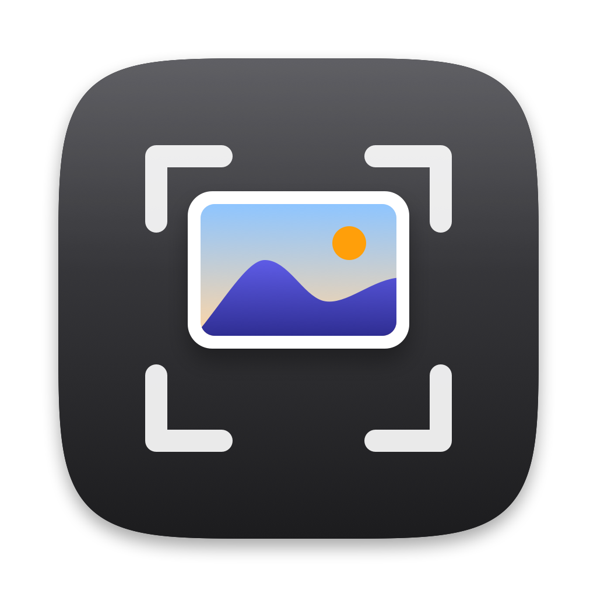

<p align="center">
  
</p>

<h1 align="center">PopShot</h1>

<p align="center">
  <b>Every screenshot and screen recording opens the moment you take it.</b><br>
  Copy, mark up, blur, crop, pin or trash it, without hunting for that tiny thumbnail in the corner.
</p>

<p align="center">
  Free · open source · native Swift · ~1.5 MB · macOS 13+
</p>

https://github.com/user-attachments/assets/81c7d716-698d-4342-bda8-948aa6f9d395

---

## Why

On a Mac, ⌘⇧3 / ⌘⇧4 / ⌘⇧5 drop a small thumbnail in the bottom-right corner. Click it within a few seconds and you can edit; miss it and the file quietly lands on your Desktop.

**PopShot opens every capture right away**, like Windows' Snipping Tool. You keep using Apple's own shortcuts; PopShot just reacts to what macOS saves.

## Features

- **Instant pop-up** for screenshots *and* screen recordings, centered on the screen you're using
- **Copy** (⌘C) straight to the clipboard; paste into Slack, WhatsApp, Gmail, Notes, Figma, anywhere
- **Copy text** from the image (⌘⇧C), using on-device OCR
- **Mark up**: arrows, boxes, pen, highlighter, text, **blur/pixelate**, crop, with undo
- **Pin** a capture above all windows as a floating reference
- **Trim** screen recordings and copy them as files
- Save As, Share, Show in Finder, Move to Trash, all from the keyboard
- Quick hover labels on every button
- Lives in the menu bar; near-zero CPU and memory while idle

Your capture is always saved to the Desktop (or wherever ⌘⇧5 › Options says). Closing the pop-up or copying never deletes it; only the Trash button does.

## Install

**Homebrew** (recommended)

```sh
brew install --cask bobdabuildrr/tap/popshot
```

**One-line installer** (no Homebrew needed)

```sh
curl -fsSL https://raw.githubusercontent.com/bobdabuildrr/PopShot/main/scripts/install.sh | bash
```

**From source** (needs only the Xcode Command Line Tools: `xcode-select --install`)

```sh
git clone https://github.com/bobdabuildrr/PopShot.git
cd PopShot
make install
```

Then take a screenshot with ⌘⇧4. On first launch, PopShot asks two things: whether to make captures pop instantly (see below) and whether to launch at login. macOS will also ask once for access to your Desktop folder, since that's where screenshots are saved.

> **About signing:** PopShot is ad-hoc signed rather than notarized with a paid Apple Developer ID. The Homebrew cask and the installer clear the download quarantine flag so Gatekeeper doesn't block it. If you'd rather not trust a binary, build from source; it takes about a minute. Because of this, System Settings › Login Items shows PopShot with a generic icon and "unidentified developer"; that goes away once the app is notarized.

## Using it

**In the pop-up**

| Key | Action |
|---|---|
| ⌘C | Copy the image (or the video file) |
| ⌘⇧C | Copy the text in the image |
| E, or double-click the image | Edit (images only) |
| P | Pin above all windows (images only) |
| T / Space | Trim / play-pause (videos only) |
| ⌘S | Save As… |
| ⌘R | Show in Finder |
| ⌘O | Open in the default app |
| ⌫ | Move to Trash |
| Esc | Close (the file stays saved) |

**In the editor**

| Key | Action |
|---|---|
| V A R P H T B C | Select · Arrow · Rectangle · Pen · Highlight · Text · Blur · Crop |
| ⌘Z / ⌘⇧Z | Undo / Redo |
| ⌫ | Delete the selected mark |
| Shift-drag | Snap arrows to 45°, draw squares |
| ⌘C | Copy the edited image |
| ⌘S | Save a copy |
| ⌘Return, or double-click the image | Done (save over the original) |
| Esc | Deselect, then cancel (press twice to discard edits) |

**Pinned images:** drag to move, scroll to resize, ⌥-scroll for opacity, double-click or Esc to close, right-click for more.

**When the pop-up closes:** when you press Esc, act on the capture (copy, trash, pin…), or click in another app. Switching desktops or apps (three-finger swipe, ⌘Tab) keeps it open and it follows you, so you can paste into an app on another desktop.

**Settings** (menu bar icon › Settings…, or open PopShot again from Finder/Spotlight): pop-up position (center, bottom-right, or wherever you last moved it), auto-close, close on click outside, auto-copy every capture, and which capture types to open.

## Instant pop-up

While Apple's floating thumbnail is on screen, macOS holds the file back for about 5 seconds before saving it. **Instant pop-up** turns that thumbnail off (the same switch as ⌘⇧5 › Options › Show Floating Thumbnail) so PopShot can open captures immediately. When you quit PopShot, your original setting is restored. Turn it off any time from the menu bar.

## Privacy

- No network access. Nothing is uploaded, ever.
- **No Screen Recording permission.** PopShot never captures your screen; macOS does, and PopShot opens the file macOS saved.
- Text recognition uses Apple's on-device Vision framework.
- About 3,000 lines of Swift with no dependencies, so you can read all of it.

## How it works

1. Reads where macOS saves captures (`com.apple.screencapture` › `location`, default `~/Desktop`) and follows changes you make in ⌘⇧5 › Options.
2. Watches that folder with FSEvents.
3. Recognizes captures by the `kMDItemIsScreenCapture` attribute macOS writes on every screenshot, or by the system "Screenshot…" / "Screen Recording…" file names.
4. Opens a floating, non-activating panel. It takes your keystrokes without stealing focus from the app you were using, like Spotlight.

## Uninstall

```sh
brew uninstall --zap popshot
# or
curl -fsSL https://raw.githubusercontent.com/bobdabuildrr/PopShot/main/scripts/install.sh | bash -s -- --uninstall
# or, from a clone
make uninstall
```

All three put Apple's floating thumbnail back the way it was.

## Known limitations

- Captures sent **only to the clipboard** (⌃⌘⇧3 / ⌃⌘⇧4) don't create a file, so PopShot can't see them.
- Captures saved by third-party tools to other folders aren't detected.
- No drag-and-drop out of the pop-up yet; use ⌘C and paste.
- Because builds are ad-hoc signed, macOS may ask for Desktop access again after an update.

## Roadmap

- Recordings: remove audio, export as GIF / compressed MP4, auto-captions (on-device)
- Drag the capture straight into other apps
- "After copying: keep the file / move it to Trash" setting
- Clipboard-only captures and extra watched folders

## Development

```sh
make run      # build and run in the foreground with logs (Ctrl-C quits cleanly)
make test     # headless self-test: detection, editor rendering & input, crop, blur, OCR
make app      # build/PopShot.app (UNIVERSAL=1 for arm64 + x86_64)
make zip      # build/PopShot.zip for a release
```

`make install` builds from your local code and installs it; `brew install` downloads a published release. Use `make` while developing.

Code map: `Capture/` finds new captures, `Popup/` is the window and every action, `Editor/` is the markup canvas and renderer, `Actions/` holds clipboard, OCR, pin and HUD, and `Settings/` holds preferences, onboarding and launch at login.

**Releasing:** push a tag like `v0.2.0`. GitHub Actions builds a universal binary, runs the self-test, publishes the release and, if a `TAP_TOKEN` secret is set, updates the Homebrew cask in `bobdabuildrr/homebrew-tap`.

Found a bug? Use **Report a Bug…** in PopShot's menu-bar menu (it fills in your versions), or open an [issue](https://github.com/bobdabuildrr/PopShot/issues/new/choose). Pull requests are welcome.

## License

[MIT](LICENSE)
